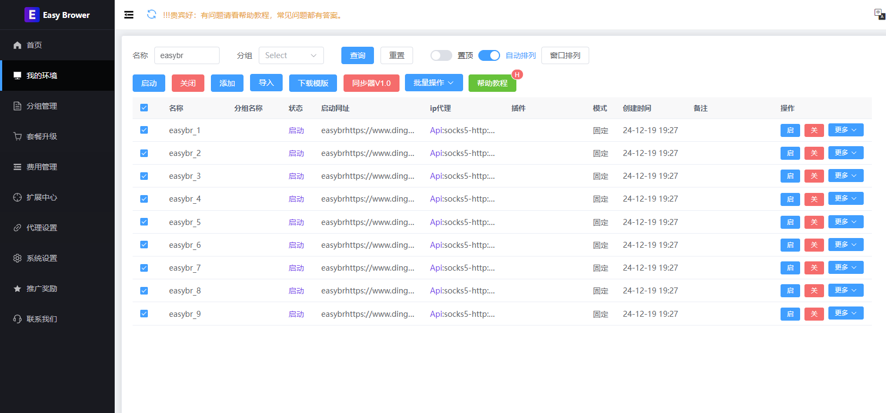

# EasyBR AI 指纹浏览器
### 用对话管理独立环境，让 AI 接着你的登录状态完成网页任务

**EasyBR 是支持 AI 对话操作的多账号指纹浏览器。** 它为不同账号提供独立浏览器环境，结合 Local API、内置 Easy WebBridge 与兼容的 AI Agent，完成环境管理、网页读取、表单填写、文件上传下载、截图和排障。支持 Windows 与 Apple 芯片 Mac；免费版提供 5 个独立环境，当前功能与套餐以[官网](https://www.ebrower.com/)为准。

[官网下载](https://www.ebrower.com/down.html) · [GitHub 海外下载](https://github.com/aiispower/easybr/releases) · [AI 上手指南](docs/AI-QUICKSTART.md) · [可复制任务指令](docs/AI-PROMPTS.md) · [English](README.en.md)

> 这个公开仓库提供产品资料、截图、示例、Agent Skill 和正式安装包。桌面客户端与浏览器内核源码不在本仓库中。

## AI 可以帮我做什么？

你给出目标、选定环境和所需资料，Agent 在指定的真实浏览器里执行，并回读页面或文件确认结果。已有环境中的 Cookie 和登录状态可以继续使用。

| 任务 | 可以完成的操作 | 结果如何核对 |
| --- | --- | --- |
| 接入与检查 | 检查安装、客户端版本、登录状态、环境和 Bridge 连接；Mac Skill 可协助下载安装 | 实际应用路径、版本、环境 ID、连接状态 |
| 独立环境 | 查询、新建、启动指定环境；在客户端配置代理与浏览器参数 | 保存结果、准确 ID、启动与连接状态 |
| 网页浏览 | 打开网站、搜索、读取页面、点击、滚动和整理信息 | 最终网址、标题与来源链接 |
| 表单与后台 | 填写指定资料、整理草稿、按明确授权提交或发布 | 表单回读、草稿或发布状态 |
| 文件处理 | 上传本地文件、下载报表或附件、截图、导出 PDF | 网站上传结果、实际文件与保存位置 |
| 多账号任务 | 按不同环境依次检查店铺、内容后台或业务系统 | 每个环境与账号分别记录结果 |
| 故障排查 | 区分客户端、账号、环境启动、Bridge、扩展和网站问题 | 原始错误、处理步骤与复测结果 |
| 开发接入 | Local API 管理环境，WebBridge 操作页面，或用 CDP 接入自动化工具 | 接口响应与实际页面行为 |

网页能否操作还取决于目标网站、登录权限和扩展实际能力。验证码、系统权限及账号安全验证出现时，用户完成必要验证后，Agent 再继续。定时任务需要由 Agent 或外部任务调度器安排。

## 三句话开始使用

**首次接入：**

```text
帮我接入 EasyBR。先检查安装、版本、登录和 Bridge 状态；需要安装时从官网下载。有账号就登录，没有账号时引导邮箱注册并接收验证码。保留已有环境，新建一个独立测试环境，打开网页并截图，最后告诉我实际完成结果和剩余问题。
```

**继续操作已登录后台：**

```text
使用我指定的 EasyBR 环境，先核对环境名称、ID 和当前网站账号。在这个已登录浏览器里检查后台待处理事项，整理成带来源链接的清单。保持其他环境和原有标签页不变。
```

**执行完整业务任务：**

```text
在我指定的 EasyBR 环境中，按我提供的资料完成本次网页任务，包括明确授权的填写、上传和提交。执行前核对账号和对象，操作后回读最终状态。提交超时先查状态，避免重复提交；遇到必须由我完成的安全验证时告诉我。
```

更多现成指令：[环境创建、单次搜索、表单、上传、下载、多环境检查、截图与诊断](docs/AI-PROMPTS.md)。

## EasyBR、WebBridge 和 AI 怎么配合？

| 组成 | 负责的事情 |
| --- | --- |
| EasyBR | 保存独立浏览器环境、Cookie、本地存储、代理与指纹配置 |
| Local API | 向本机工具提供环境查询、创建、启动等管理能力 |
| Easy WebBridge | 把 Agent 的命令交给指定的已打开浏览器，执行页面操作 |
| AI Agent / Skill | 理解你的任务、选择工具、执行步骤、检查结果和处理异常 |

EasyBR 1.7.8 及以后内置 Bridge 与扩展，启动环境时自动加载；是否接通以目标环境出现在连接列表中为准。普通 Chrome、Edge、QQ 浏览器也可单独接入 Easy WebBridge，安装方法见[官方教程](https://www.ebrower.com/helperdoc/easy-webbridge.html)。

### 浏览器本身的能力

- **环境隔离**：分别管理不同任务和账号的 Cookie、Local Storage 与浏览器环境。
- **浏览器指纹配置**：管理 User-Agent、语言、时区、Canvas、WebGL、音频等参数，具体效果以所用内核和设置为准。
- **代理管理**：为不同环境配置代理连接，按任务检查网络出口。
- **账号与资料管理**：组织环境、分组、备注及账号工作流。
- **迁移与团队协作**：按当前套餐使用环境迁移、同步和团队权限。
- **自动化扩展**：连接通用 Agent、业务 Skill 及现有开发工具。



## 下载和安装

| 入口 | 用途 |
| --- | --- |
| [官网下载中心](https://www.ebrower.com/down.html) | Windows 与 Apple 芯片 Mac 的正式下载 |
| [GitHub Releases](https://github.com/aiispower/easybr/releases) | 海外公开下载、按系统区分的版本和附件 |
| [Mac 1.7.15 手动安装包](https://github.com/aiispower/easybr/releases/download/mac-v1.7.15/easybrmac.zip) | Mac ARM64 正式安装合集 |
| [Mac 1.7.15 全部附件](https://github.com/aiispower/easybr/releases/tag/mac-v1.7.15) | App 更新 ZIP、DMG、校验文件和更新清单 |

下载 Release 附件不需要发布令牌。Windows 安装包在对应的 `windows-v<版本>` Release 下发布；没有列出的系统或架构请先查看官网下载中心，不要把 Mac ARM64 包用于 Windows 或 Intel Mac。

## 安装 easybr-agent Skill（Mac）

1. 下载 [easybr-agent.zip](https://github.com/aiispower/easybr/raw/refs/heads/main/downloads/easybr-agent.zip) 并解压。
2. 将完整的 `easybr-agent` 文件夹放入兼容 Agent 的 Skill 目录。Codex 默认目录为 `~/.codex/skills/`，其他工具以其文档为准。
3. 让 Agent 读取 Skill，按[AI 上手指南](docs/AI-QUICKSTART.md)检查连接并开始任务。

EasyBR 内置 Bridge 使用客户端自己的运行时；用户无需为了它另装 Node.js。运行本仓库 Mac 辅助脚本的 Agent 需要本机文件和命令能力，以及 Node.js 20 或更新版本。Windows 已安装环境可通过 Easy WebBridge 和 Local API 接入；本仓库的 Mac 安装 Skill 不代替 Windows 安装流程。

## 教程和开发入口

- [AI 对话上手与排障](docs/AI-QUICKSTART.md)
- [可复制任务指令库](docs/AI-PROMPTS.md)
- [官网帮助教程](https://www.ebrower.com/helperdoc/easybrintroduce.html)
- [Windows / Mac：通过 AI 对话使用 EasyBR](https://www.ebrower.com/helperdoc/ai-agent-workflow.html)
- [Easy WebBridge 使用指南](https://www.ebrower.com/helperdoc/easy-webbridge.html)
- [Local API 文档](https://www.ebrower.com/helperdoc/apidoc.html)
- [Mac 首次安装补充说明](https://www.ebrower.com/helperdoc/ai-browser-mac.html)
- [CDP 示例说明](node-demo/README.md) · [Skill 源码](skills/easybr-agent/) · [产品截图](images/)

## 常见问题

**只把这个网页给 AI 就能控制电脑吗？**
AI 需要有本机工具权限，并能访问运行中的 EasyBR 与 Bridge。纯网页聊天若没有这些工具，无法直接安装本机应用或操作浏览器。[上手条件与步骤](docs/AI-QUICKSTART.md#使用前需要准备什么)

**一定要重新登录每个网站吗？**
选定的 EasyBR 环境若已有有效登录状态，Agent 可以继续使用。网站要求重新登录或设备验证时按页面完成。

**能直接发布内容或提交业务操作吗？**
可以让 Agent 执行你明确授权的完整任务；任务应写清账号、对象、资料和范围。最终以网站回读结果为准，不把点击按钮当作成功。

**连接失败就要重装吗？**
先分别检查管理端、登录、目标环境、Bridge 和扩展。窗口已打开不等于 Agent 的本机连接一定可用，具体步骤见[排障指南](docs/AI-QUICKSTART.md#连接不上时怎样排查)。

---

**English:** EasyBR is an AI-ready fingerprint browser for isolated profiles and multi-account workflows. Built-in Easy WebBridge lets a compatible local agent browse, fill forms, upload and download files, capture screenshots, and work in your selected signed-in browser. [Read the English overview](README.en.md).

产品咨询、技术支持与定制需求请通过[官网](https://www.ebrower.com/)联系团队。资料更新：2026-10-24。
